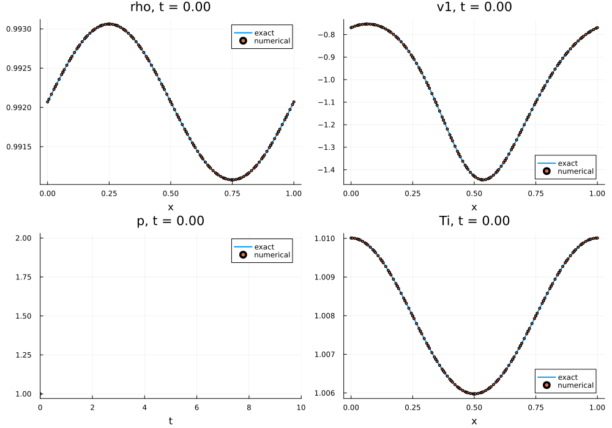
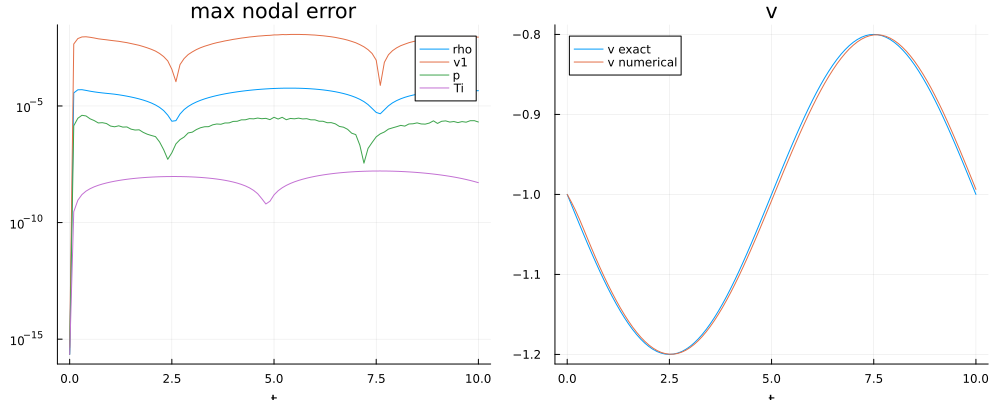
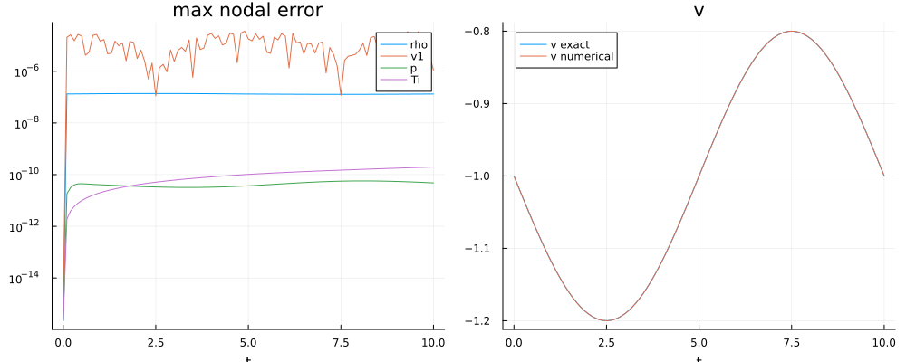

# Manufactured solution

For the termite mound model, no exact solution is known. Therefore, we will validate our
numerical results against a manufactured solution. Later, we will compare both numerical
methods against the constructed analytical solution.

## Idea

1. **Choose the solution.** We prescribe smooth fields ``\hat\rho``, ``\hat u``,
   ``\hat p_0``, ``\hat v`` and ``\hat T_i``, built from sines and cosines. They are
   periodic in ``x`` and have all the key properties that a solution of the model should have. Since the fields are given by formulas, all their
   derivatives in space and time are known exactly.
2. **Add forcing terms.** In general, the chosen fields do not solve the termite mound
   equations. Therefore, we add **source terms** ``s_\rho``, ``s_T``, ``s_p`` and ``s_v`` to
   the equations. Each source term is the difference between the left-hand side and the
   right-hand side of its equation, evaluated with the chosen fields. With these source
   terms, the chosen fields are an **exact solution of the forced equations**.
3. **Compare.** We solve the forced equations numerically and compare the result with the
   chosen fields. The error must decrease when the mesh and the time step are refined.

Note that the manufactured solution does **not** solve the original termite mound model; instead, it is an analytical solution of the termite mound model **with additional forcing terms**. It tests the numerical method,
not the physics.

## Termite mound equations with additional forcing

The manufactured solution solves
```math
\begin{aligned}
\frac{\partial \rho}{\partial t} + \frac{\partial (\rho u)}{\partial x}
  &= -\frac{A_x}{A} \rho u + s_\rho, \\
\frac{\partial T_i}{\partial t} &= k_i (T - T_i) + s_T, \\
\frac{\mathrm{d} p_0}{\mathrm{d} t}
  &= -\gamma p_0 \left( \frac{\partial u}{\partial x} + \frac{A_x}{A} u \right)
     - \frac{k_w}{\sqrt{A}} (T - T_u) + s_p, \\
\left( \int_0^1 \frac{\rho}{A} \, dx \right) \frac{\mathrm{d} v}{\mathrm{d} t}
  &= \int_0^1 \left[ F_v + s_v \right] dx, \\
p_0 &= \rho T, \qquad A(0) \, u(t, 0) = v(t),
\end{aligned}
```
with the momentum integrand
``F_v = -\rho u u_x - \frac{\beta}{A} \rho u \big(\eta + (1-\eta)|u|\big) - \frac{h_x}{Fr^2} (\rho - \rho_{h_0})``.
The source terms are obtained by inserting the chosen fields:
```math
\begin{aligned}
s_\rho &= \hat\rho_t + (\hat\rho \hat u)_x + \frac{A_x}{A} \hat\rho \hat u, \\
s_T &= \hat T_{i,t} - k_i (\hat T - \hat T_i), \\
s_p &= \hat p_0' + \gamma \hat p_0 \left( \hat u_x + \frac{A_x}{A} \hat u \right)
       + \frac{k_w}{\sqrt{A}} (\hat T - \hat T_u), \\
s_v &= \frac{\hat\rho}{A} \hat v' - \hat F_v,
\end{aligned}
```
with ``\hat T = \hat p_0 / \hat\rho``. The source ``s_p`` depends on ``x`` and also enters
the velocity constraint. Only then can the velocity ``\hat u`` be chosen freely.

## Chosen fields

The fields are traveling waves around the initial state of the termite mound simulations.
With ``\omega = 2\pi/10`` (one period for ``t \in [0, 10]``) and ``k = 2\pi``:
```math
\begin{aligned}
\hat\rho &= \rho_0 \big(1 + \varepsilon_\rho \sin(kx + \omega t)\big), &
\hat p_0 &= 1 + \varepsilon_p \sin(\omega t), \\
\hat v &= v_0 \big(1 + \varepsilon_v \sin(\omega t)\big), &
\hat T_i &= T_{i,0} \big(1 + \varepsilon_T \cos(kx - \omega t)\big), \\
\hat u &= \frac{\hat v + w}{A}, &
w &= \varepsilon_u \big(1 + \tfrac{1}{2} \sin(\omega t)\big) \sin(kx),
\end{aligned}
```
with ``\varepsilon_\rho = 10^{-3}``, ``\varepsilon_p = 10^{-3}``, ``\varepsilon_v = 0.2``,
``\varepsilon_u = 0.1`` and ``\varepsilon_T = 2 \cdot 10^{-3}``. Here ``\rho_0 = 1/T_0`` and
``T_{i,0} = T_0`` with the initial air temperature ``T_0``, and ``v_0`` is the initial
velocity. Key properties:
- all fields are smooth and periodic in ``x``, and ``\hat p_0`` only depends on time,
- ``w(t, 0) = 0``, so ``A(0) \hat u(t, 0) = \hat v(t)`` holds exactly.

!!! note
    This manufactured solution only tests solutions with negative velocities. A similar
    manufactured solution can be constructed for purely positive velocities.

!!! note 
    The density perturbation ``\varepsilon_\rho`` must stay small. A larger density perturbation makes the
    manufactured solution unstable.

## Comparison of the numerical methods

We solve the forced equations with both methods on ``t \in [0, 10]``, with the variable
cross section ``A(x) = 1 + 0.3 \sin(2\pi x + \pi/2)`` (so that all ``A`` and ``A_x`` terms
are active), polynomial degree 4 and refinement level 5. The examples are
`examples/manufactured_solutions/elixir_manufactured_splitting.jl` and
`examples/manufactured_solutions/elixir_manufactured_coupled.jl`. The additional sources are passed as
follows:
```julia
# splitting
semi = SemidiscretizationHyperbolic(mesh, equations, ManufacturedInitialCondition, dg,
                                    source_terms = manufactured_source_terms,
                                    boundary_conditions = boundary_condition_periodic)
godunov_splitting_callback =
    GodunovSplittingCallback(CarpenterKennedy2N54(williamson_condition = false),
                             source_terms = manufactured_source_terms_ode)

# coupled
semi = SemidiscretizationHyperbolic(mesh, equations, ManufacturedInitialCondition, dg,
                                    source_terms = CoupledSourceTerms(manufactured_source_terms;
                                                                      ode_source_terms = manufactured_source_terms_ode),
                                    boundary_conditions = boundary_condition_periodic)
```

### Splitting method

Numerical (markers) and exact (lines) solution of the four variables ``\rho``, ``u``,
``p_0`` and ``T_i``. Since ``p_0`` is constant in space, it is shown over time:



Maximum nodal error of ``\rho``, ``u`` (`v1` in the plot), ``p_0`` and ``T_i`` over time (left) and the auxiliary velocity ``v``,
exact and numerical (right):



### Coupled method

Numerical (markers) and exact (lines) solution of the four variables ``\rho``, ``u``,
``p_0`` and ``T_i``. Since ``p_0`` is constant in space, it is shown over time:


Maximum nodal error of ``\rho``, ``u`` (`v1` in the plot), ``p_0`` and ``T_i`` over time (left) and the auxiliary velocity ``v``,
exact and numerical (right):



### Result

Both methods converge to the manufactured solution, but with different rates. When the
mesh is refined (with a fixed CFL number), the error of the **splitting** method decreases
only with **first order**, because the splitting error dominates. The error of the
**coupled** method decreases with about **fifth order**, the order of the DG method with
polynomial degree 4.
