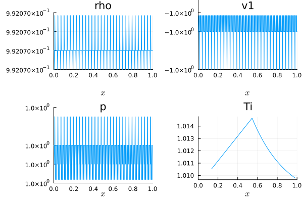
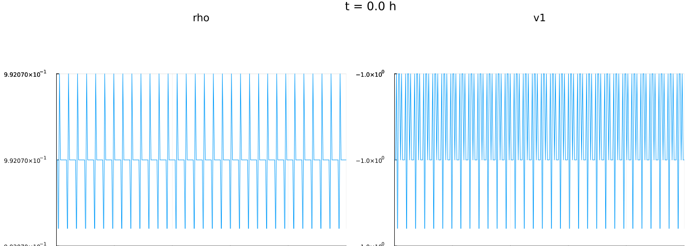
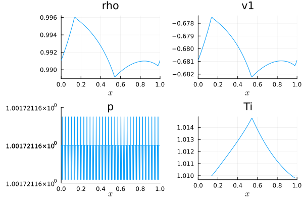

# Tutorial

In this section, we describe how to use **TermiteMoundInducedAirflowTrixi.jl** with
**Trixi.jl**. At the end of this guide, you will find the
[complete code](#Complete-code) to copy and run.

## Step 0: Install and load the packages

You need [Julia](https://julialang.org/downloads/) (version 1.10 or newer). Install the
packages once in the Julia REPL:
```julia
using Pkg
Pkg.add(["TermiteMoundInducedAirflowTrixi", "Trixi", "OrdinaryDiffEqLowStorageRK", "Plots"])
using TermiteMoundInducedAirflowTrixi
using Trixi
using OrdinaryDiffEqLowStorageRK
using Plots
```

## Step 1: Model parameters

The function `termite_parameters(r, h)` computes all required model parameters for a mound
with radius `r` and height `h` (both in meters):
```julia
(γ, k_i, k_w, tᵣ, uᵣ, xa, xb, xc, r, h, L, β, η, Fr², ρₕ₀, T_ref, t_ref, T0, v0, Ti_LI) =
    termite_parameters(0.6, 2.0);
```

## Step 2: Model data

Next, we set the cross section, height profile and boundary temperature functions for the simulation:
```julia
cross_section = CrossSectionConstant();
height_profile = HeightProfileTermiteMound(; xa, xb, L, h);
boundary_temperature = BoundaryTemperatureTermiteMound(; xa, xb, xc, tᵣ, T_ref);
```

## Step 3: Equations

The parameters and functions are used to create the equations object:
```julia
equations = TermiteMoundEquations1D(; γ, k_i, k_w, tᵣ, uᵣ, xa, xb, xc, r, h, L, β, η, Fr², ρₕ₀,
                                    T_ref, t_ref, T0, v0, Ti_LI,
                                    cross_section, height_profile, boundary_temperature)
```

## Step 4: Initial condition

Our simulation starts with constant initial states of the flow quantities:
```julia
initial_condition = TermiteMoundInitialCondition;
```

## Step 5: Spatial discretization (DG solver)

The equations are solved with the discontinuous Galerkin spectral element method (DGSEM):
```julia
volume_flux = flux_ranocha;
surface_flux = flux_hllc;
dg = DGSEM(polydeg = 4, surface_flux = surface_flux,
           volume_integral = VolumeIntegralFluxDifferencing(volume_flux))
```

## Step 6: Mesh

We define a one-dimensional tree mesh:
```julia
mesh = TreeMesh((0.0,), (1.0,), initial_refinement_level = 5, n_cells_max = 1000,
                periodicity = true)
```

## Step 7: Semidiscretization (coupled method)

The semidiscretization is now defined:
```julia
semi = SemidiscretizationHyperbolic(mesh, equations, initial_condition, dg,
                                    source_terms = CoupledSourceTerms(source_terms),
                                    boundary_conditions = boundary_condition_periodic)
```

!!! note 
    Always use the coupled implementation to solve the termite mound equations.

## Step 8: Time span

We want to simulate a full day. In this case, we set the time span to:
```julia
tspan = (0.0, 86400 / equations.tᵣ);
ode = semidiscretize(semi, tspan);
```

## Step 9: Callbacks

We add the following callbacks to our callback set:
```julia
summary_callback = SummaryCallback();
algebraic_velocity_callback = AlgebraicVelocityCallback()
stepsize_callback = StepsizeCallback(cfl = 3.0)
callbacks = CallbackSet(summary_callback, algebraic_velocity_callback, stepsize_callback);
```

!!! note 
    `algebraic_velocity_callback` must be listed **before** `stepsize_callback` inside the callback set!

## Step 10: Run the simulation

Finally, we can solve the system of equations. The solution is saved at multiple points in time:
```julia
sol = solve(ode, CarpenterKennedy2N54(williamson_condition = false);
            dt = 1.0, ode_default_options()...,
            saveat = 1800 / equations.tᵣ, callback = callbacks);
```

## Step 11: Plot the results

We can plot the **initial state** of our flow quantities using:
```julia
pd_init = PlotData1D(sol.u[1], semi);
plot(pd_init)
savefig("initial.png")
```


The time evolution of the density and velocity can be visualized with:
```julia
anim = @animate for i in eachindex(sol.t)
    pd = PlotData1D(sol.u[i], semi);
    hours = round(sol.t[i] * equations.tᵣ / 3600, digits = 1);
    plot(plot(pd["rho"]), plot(pd["v1"]), layout = (1, 2), size = (1200, 450),
         plot_title = "t = $hours h");
end;
gif(anim, "evolution.gif", fps = 5);
```


The **final state** after 24 hours:
```julia
pd_final = PlotData1D(sol);
plot(pd_final)
savefig("final.png")
```


## Complete code

```julia
using Pkg
Pkg.add(["TermiteMoundInducedAirflowTrixi", "Trixi", "OrdinaryDiffEqLowStorageRK", "Plots"])
using TermiteMoundInducedAirflowTrixi
using Trixi
using OrdinaryDiffEqLowStorageRK
using Plots
(γ, k_i, k_w, tᵣ, uᵣ, xa, xb, xc, r, h, L, β, η, Fr², ρₕ₀, T_ref, t_ref, T0, v0, Ti_LI) =
    termite_parameters(0.6, 2.0);
cross_section = CrossSectionConstant();
height_profile = HeightProfileTermiteMound(; xa, xb, L, h);
boundary_temperature = BoundaryTemperatureTermiteMound(; xa, xb, xc, tᵣ, T_ref);
equations = TermiteMoundEquations1D(; γ, k_i, k_w, tᵣ, uᵣ, xa, xb, xc, r, h, L, β, η, Fr², ρₕ₀,
                                    T_ref, t_ref, T0, v0, Ti_LI,
                                    cross_section, height_profile, boundary_temperature)
initial_condition = TermiteMoundInitialCondition;
volume_flux = flux_ranocha;
surface_flux = flux_hllc;
dg = DGSEM(polydeg = 4, surface_flux = surface_flux,
           volume_integral = VolumeIntegralFluxDifferencing(volume_flux))
mesh = TreeMesh((0.0,), (1.0,), initial_refinement_level = 5, n_cells_max = 1000,
                periodicity = true)
semi = SemidiscretizationHyperbolic(mesh, equations, initial_condition, dg,
                                    source_terms = CoupledSourceTerms(source_terms),
                                    boundary_conditions = boundary_condition_periodic)
tspan = (0.0, 86400 / equations.tᵣ);
ode = semidiscretize(semi, tspan);
summary_callback = SummaryCallback();
algebraic_velocity_callback = AlgebraicVelocityCallback()
stepsize_callback = StepsizeCallback(cfl = 3.0)
callbacks = CallbackSet(summary_callback, algebraic_velocity_callback, stepsize_callback);
sol = solve(ode, CarpenterKennedy2N54(williamson_condition = false);
            dt = 1.0, ode_default_options()...,
            saveat = 1800 / equations.tᵣ, callback = callbacks);
pd_init = PlotData1D(sol.u[1], semi);
plot(pd_init)
savefig("initial.png")
anim = @animate for i in eachindex(sol.t)
    pd = PlotData1D(sol.u[i], semi);
    hours = round(sol.t[i] * equations.tᵣ / 3600, digits = 1);
    plot(plot(pd["rho"]), plot(pd["v1"]), layout = (1, 2), size = (1200, 450),
         plot_title = "t = $hours h");
end;
gif(anim, "evolution.gif", fps = 5);
pd_final = PlotData1D(sol);
plot(pd_final)
savefig("final.png")

```
